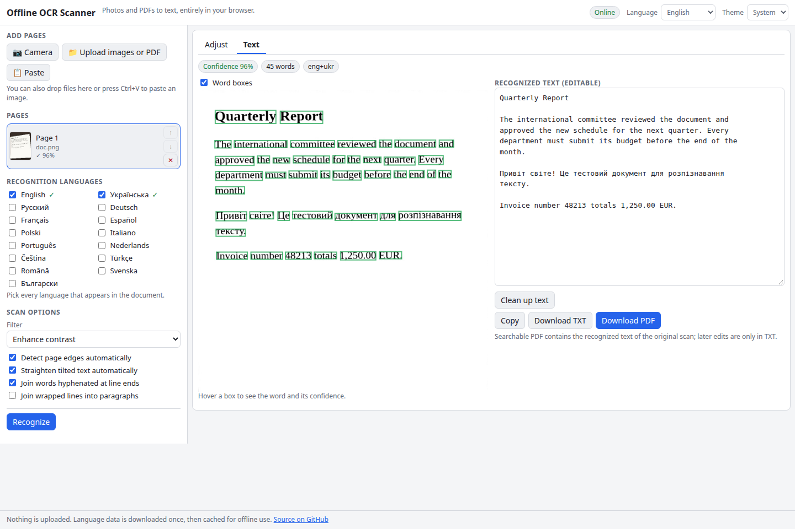

# Offline OCR Scanner

Turn photos of documents into text. Take a picture or upload an image or PDF, let the app find the page, flatten its perspective and straighten the text, then read it with Tesseract. You get editable text, a TXT download or a searchable PDF. Everything runs in your browser, nothing is uploaded, and after the first use it works offline.

**Try it: [hermes98761234.github.io/offline-ocr-scanner](https://hermes98761234.github.io/offline-ocr-scanner/)**

[](https://github.com/hermes98761234/offline-ocr-scanner/actions/workflows/deploy.yml)



## Features

- **Many ways in.** Live camera (`getUserMedia`, with the phone's camera app as a fallback), image and PDF upload (pdf.js renders each page), paste from the clipboard, or drag and drop.
- **Document scanner pre-processing.** Automatic page detection, draggable 4-corner crop with perspective correction (own homography implementation), rotate, automatic or manual deskew, grayscale, contrast enhancement and adaptive black-and-white thresholding, with a live preview.
- **Tesseract.js v7 in a worker.** Multi-select languages (English, Ukrainian, Russian, German, French, Spanish, Polish and more); progress and confidence are shown.
- **Word boxes** drawn over the page, coloured by confidence, with the word shown on hover.
- **Editable text**, copy, download TXT, one-click clean-up (dehyphenation, ligatures, optional paragraph reflow).
- **Searchable PDF export** using Tesseract's PDF output, merged across pages with pdf-lib.
- **Batch.** Add many pages, reorder them, recognize all, export all.
- **Offline.** A service worker precaches the app and caches the Tesseract core and language data on first use. Language data is also kept in IndexedDB by Tesseract.
- English and Ukrainian UI, light/dark/system theme, settings remembered in the browser.

## How it works

Pixel work lives in `src/lib` as pure functions with unit tests: a homography solved from four point pairs (Gaussian elimination) drives a bilinear perspective warp; Otsu, Bradley-Roth adaptive (integral image) and percentile contrast filters; a projection-profile deskew estimator; page detection from the largest bright blob; and text post-processing (dehyphenation, whitespace, reflow). They run in a Web Worker (`pipeline.worker.ts`), so the UI stays responsive. OCR runs in Tesseract's own worker.

The Tesseract worker and the single-threaded LSTM WASM core are served from the site itself (no COOP/COEP headers needed). **Language data (`*.traineddata`) is downloaded from the jsDelivr CDN the first time a language is used**, then cached. That first download needs a connection; afterwards the scanner works fully offline.

Limitations: the searchable PDF holds the text recognized from the scan, so edits you make in the text box only go to TXT. Handwriting and very low-quality photos need luck, as with any Tesseract setup. HEIC photos need a browser that can decode them.

## Quick start

You need [Node.js](https://nodejs.org/) 22.

```bash
git clone https://github.com/hermes98761234/offline-ocr-scanner.git
cd offline-ocr-scanner
npm install
npm run dev       # http://localhost:5173
npm test          # homography, filters, deskew, text and settings tests
npm run build     # static site in dist/ (includes sw.js)
```

## License

MIT
